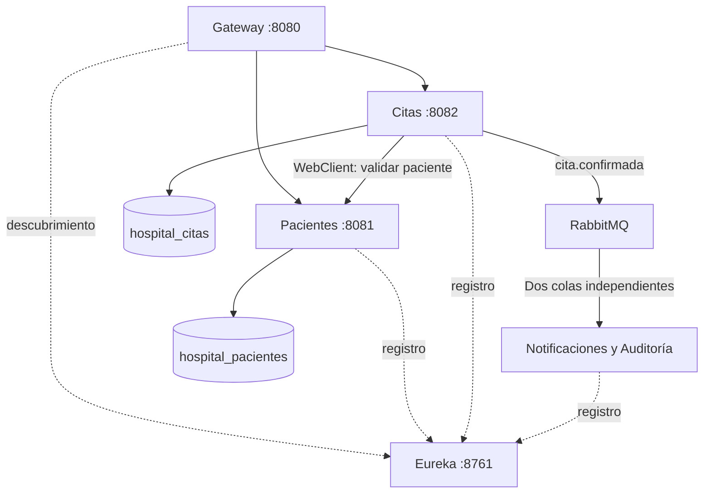

# Hospital Vida Salud — T2

Proyecto académico de microservicios para registrar pacientes y gestionar
citas. Utiliza exclusivamente datos ficticios.

## Alcance

Se implementaron Pacientes, Citas y un servicio consumidor que agrupa
Notificaciones y Auditoría.

Se seleccionó este flujo para demostrar registro, validaciones,
comunicación entre servicios, persistencia reactiva y eventos RabbitMQ.
Atenciones, Laboratorio, Hospitalización, Farmacia y Pagos quedan fuera
del alcance seleccionado.

## Tecnologías

- Java 21.
- Spring Boot 4.0.8 y Spring Cloud 2025.1.3.
- Spring WebFlux, Mono, Flux y Spring Data R2DBC.
- PostgreSQL.
- Spring Cloud Gateway y Eureka.
- RabbitMQ y Spring AMQP.
- Maven, Git y GitHub Actions.

## Servicios

| Servicio | Puerto | Responsabilidad |
|---|---:|---|
| eureka-server | 8761 | Registro y descubrimiento |
| api-gateway | 8080 | Entrada HTTP y enrutamiento |
| pacientes-service | 8081 | Registro, actualización y consultas |
| citas-service | 8082 | Programación y gestión de citas |
| notificaciones-service | Sin puerto HTTP | Consumir eventos y registrar logs |

## Arquitectura



Cada servicio administra sus propios datos. Citas guarda el identificador
del paciente y consulta su existencia por HTTP; no accede a sus tablas
ni utiliza claves foráneas entre bases independientes.

## Ejecución local

Requisitos: Java 21, Maven, PostgreSQL y Docker Desktop.

1. Crear estas bases de datos en PostgreSQL:
    - hospital_pacientes
    - hospital_citas
    - hospital_pacientes_test

2. Configurar DB_PASSWORD en las variables de entorno de pacientes y citas.
   DB_USERNAME es opcional y utiliza postgres por defecto.
   No guardar contraseñas reales en el repositorio.

3. Iniciar RabbitMQ:

```bash
docker run -d \
  --name hospital-rabbitmq \
  --hostname hospital-rabbitmq \
  -p 127.0.0.1:5672:5672 \
  -p 127.0.0.1:15672:15672 \
  -v hospital-rabbitmq-data:/var/lib/rabbitmq \
  rabbitmq:4-management
```

Si el contenedor ya existe:

```bash
docker start hospital-rabbitmq
```

Panel local: http://localhost:15672.
Para esta demostración local se utiliza el usuario predeterminado guest.

4. Importar los pom.xml como proyectos Maven en IntelliJ.
5. Ejecutar las clases principales en este orden:
   Eureka, Pacientes, Citas, Notificaciones y Gateway.

Las tablas de pacientes y citas se crean mediante sus archivos schema.sql.

## Endpoints

Todas las solicitudes externas se realizan por http://localhost:8080.

| Método | Ruta | Operación |
|---|---|---|
| POST | /api/pacientes | Registrar paciente |
| GET | /api/pacientes | Listar pacientes |
| GET | /api/pacientes/{id} | Consultar paciente |
| GET | /api/pacientes/documento?tipo=DNI&numero=00000001 | Buscar por documento |
| PUT | /api/pacientes/{id} | Actualizar paciente |
| POST | /api/citas | Registrar cita |
| GET | /api/citas | Listar citas |
| GET | /api/citas/{id} | Consultar cita |
| GET | /api/citas/paciente/{pacienteId} | Consultar citas del paciente |
| PATCH | /api/citas/{id}/confirmar | Confirmar |
| PATCH | /api/citas/{id}/reprogramar | Cambiar horario |
| PATCH | /api/citas/{id}/cancelar | Cancelar |

Ejemplo de registro de cita; utilizar un paciente existente y una fecha futura:

```json
{
  "pacienteId": 1,
  "especialidad": "Medicina general",
  "fechaHora": "2026-10-20T10:00:00-05:00",
  "profesionalCodigo": "PROF-001",
  "motivo": "Consulta administrativa de prueba"
}
```

Body para reprogramar:

```json
{
  "fechaHora": "2026-10-21T11:00:00-05:00"
}
```

Confirmar y cancelar no requieren Body.

## Reglas y estados

- El tipo y número de documento del paciente no pueden duplicarse.
- Las citas requieren un paciente existente y una fecha futura.
- Un paciente o profesional no puede tener dos citas no canceladas
  con la misma fecha y hora.
- La agenda se simplifica a coincidencias exactas de horario;
  no se modelan duración ni intervalos superpuestos.
- Las citas se crean como PENDIENTES.
- Solo una cita PENDIENTE y futura puede pasar a CONFIRMADA.
- PENDIENTE y CONFIRMADA permiten reprogramación o cancelación.
- Reprogramar devuelve la cita a PENDIENTE.
- CANCELADA es un estado final y libera el horario.
- ATENDIDA y AUSENTE están reservados en el esquema; no tienen
  operaciones implementadas en este alcance.

## Comunicación síncrona

Citas consulta GET /api/pacientes/{id} mediante WebClient y descubrimiento
Eureka antes de guardar.

- 404: paciente inexistente.
- 503: servicio no disponible o error al validar.
- 504: tiempo de espera superior a cinco segundos.
- 409: horario ocupado o transición de estado inválida.
- 400: datos de entrada inválidos.

## Eventos RabbitMQ

- Exchange durable: hospital.eventos.
- Tipo: topic.
- Routing key: cita.confirmada.
- Colas durables: hospital.notificaciones y hospital.auditoria.
- Productor: citas-service.
- Consumidor: notificaciones-service, con dos listeners independientes.

CitaConfirmadaEvent incluye eventoId, citaId, pacienteId, especialidad,
fechaHora, estadoAnterior, estadoNuevo, fechaEvento y origen.

La notificación se simula mediante logs. Auditoría registra el recurso,
los estados, la fecha y el origen. Reprogramación y cancelación registran
su trazabilidad en los logs de citas-service.

RabbitTemplate se ejecuta en boundedElastic para evitar bloquear los hilos
que atienden solicitudes WebFlux. El acceso SQL utiliza R2DBC.

La transacción de confirmación protege la actualización SQL ante errores
propagados de publicación. No constituye una transacción distribuida
entre PostgreSQL y RabbitMQ. Este alcance no incorpora outbox,
confirmaciones del publicador ni deduplicación persistente del consumidor.

## Integración continua: un solo endpoint

El workflow .github/workflows/ci-pacientes.yml compila pacientes-service
y ejecuta exclusivamente PacienteEndpointTest para POST /api/pacientes.

Se activa en push a main, pull requests hacia main y ejecución manual.
Utiliza Java 21 y una base PostgreSQL temporal con el perfil test.

Casos automatizados:

1. Registro válido: 201 y persistencia del paciente.
2. Documento duplicado: 409.
3. Datos inválidos: 400.

Con DB_PASSWORD configurada y la base hospital_pacientes_test disponible,
ejecutar desde pacientes-service:

```bash
mvn -B -Dtest=PacienteEndpointTest verify
```

Se demostró un fallo controlado esperando 200 en lugar de 201.
Después se restauró la expectativa correcta y la ejecución pasó.

PR de evidencia:
https://github.com/AkorDR/hospital-vida-salud-t2/pull/1